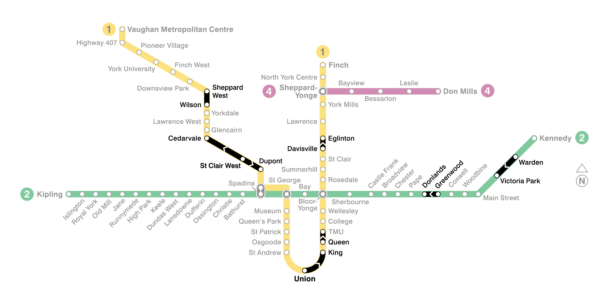

# ttc-slow-zones
This repository tracks changes of the [TTC's reduced speed zones](https://www.ttc.ca/riding-the-ttc/Updates/Reduced-Speed-Zones) over time with git.

The TTC's internal slow-zone list changes multiple times a day and publsihed data lags behind, so this repo isn't *perfect*.

Updated: 2026-11-26 10:11

  
<small>This map may be out of date relative to the actual slow zones presented below.</small>


```diff
  | Ln | From           | To            | Direction            |
  | -- | -------------- | ------------- | -------------------- |
  | 1  | Sheppard West  | Wilson        | South towards Finch  |
  | 1  | Wilson         | Sheppard West | North towards VMC    |
  | 1  | St. Clair West | Cedarvale     | North towards VMC    |
  | 1  | St. Clair West | Dupont        | South towards Finch  |
  | 1  | Union          | King          | North towards Finch  |
  | 1  | Queen          | TMU           | North towards Finch  |
- | 1  | TMU            | College       | North towards Finch  |
  | 1  | Davisville     | Eglinton      | North towards Finch  |
  | 2  | Greenwood      | Donlands      | West towards Kipling |
  | 2  | Warden         | Victoria Park | West towards Kipling |
```
